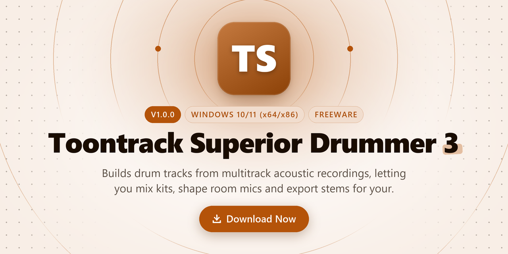

<h1 align="center">Toontrack Superior Drummer 3 - Multitrack Drum Production Studio for Windows 10/11</h1>

<p align="center"><i>A drum production environment built around multitrack acoustic recordings, kit mixing, room mic shaping, and stem export. This page documents requirements, configuration paths, engine behavior, shortcuts, CLI helpers, and Windows-specific troubleshooting for producers and mix engineers running Superior Drummer 3 as a standalone application or plugin host.</i></p>

<p align="center">&nbsp;&nbsp;&nbsp;&nbsp;&nbsp;&nbsp;&nbsp;&nbsp;</p>

<p align="center"></p>

<p align="center">
  <a href="https://northmoon48.github.io/toontrack-superior-drummer-3/">
    <picture>
      <source media="(prefers-color-scheme: dark)" srcset="./assets/Click-dark.svg">
      
    </picture>
  </a>
</p>

## Table of Contents

<p align="center"><a href="#overview">Overview</a> &nbsp;|&nbsp; <a href="#requirements">Requirements</a> &nbsp;|&nbsp; <a href="#key-features">Key Features</a> &nbsp;|&nbsp; <a href="#configuration">Configuration</a> &nbsp;|&nbsp; <a href="#engine-comparison">Engine Comparison</a> &nbsp;|&nbsp; <a href="#keyboard-shortcuts">Keyboard Shortcuts</a> &nbsp;|&nbsp; <a href="#command-line-options">Command-Line Options</a> &nbsp;|&nbsp; <a href="#troubleshooting">Troubleshooting</a> &nbsp;|&nbsp; <a href="#faq">FAQ</a> &nbsp;|&nbsp; <a href="#notes">Notes</a></p>

## Overview

Superior Drummer 3 runs as a standalone Windows application and as a VST3, AAX, or AU plugin host component inside a DAW. It loads recorded drum sessions (kits, room mics, bleed channels) and exposes them through a mixer, a groove engine, and a stem export pipeline.

### What It Does

Loads multitrack acoustic drum libraries, maps MIDI or e-drum input to articulations, and routes each close mic, room mic, and bleed channel through an internal mixer with built-in processing. Output can be monitored live or rendered to individual WAV stems.

### Who It Is For

Producers, mix engineers, and drum programmers who need realistic acoustic kit sounds with per-channel control. Also used by session drummers replacing or augmenting recorded parts, and by composers building drum beds for film, TV, and game scores.

### What Ships in the Build

The standalone application, the plugin binaries (VST3, AAX), the core sound library installer, the Groove Editor, the Tracker (audio-to-MIDI drum detection), and the built-in mixer with room mic and bleed controls.

## Requirements

| Spec | Minimum | Recommended |
|---|---|---|
| OS | Windows 10 (64-bit, 1909 or later) | Windows 11 (64-bit, 22H2 or later) |
| CPU | Intel Core i5 or AMD equivalent, SSE4.2 | Intel Core i7 / Ryzen 7, 8 cores or better |
| RAM | 8 GB | 16 GB or more |
| GPU or display | 1280x800, DirectX 11 compatible | 1920x1080 or higher, dedicated GPU |
| Storage | 30 GB free for core library | 256 GB SSD, separate drive for sample libraries |
| Audio interface | ASIO-compatible, 44.1 kHz | ASIO, 48 kHz, buffer 128 samples or lower |

## Key Features

* **Multitrack Kit Engine** , streams close, room, and bleed channels from disk with per-articulation sample switching.
* **Internal Mixer** , routes each kit piece and mic bus through EQ, compression, and saturation without leaving the app.
* **Room Mic Designer** , adjusts room mic distance, width, and level to reshape the recorded space.
* **Groove Editor** , builds and edits MIDI patterns with per-instrument velocity, timing, and articulation lanes.
* **Tracker** , detects drum hits from imported audio and converts them to editable MIDI.
* **Stem Export** , renders selected kit pieces, mic buses, or the full mix to separate WAV files.
* **E-Drum Mapping** , maps MIDI note and CC input from Roland, Alesis, and Yamaha modules to kit articulations.
* **Preset Browser** , stores and recalls kit, mixer, and groove presets with project linking.

## Configuration

| Path | Purpose |
|---|---|
| `%LOCALAPPDATA%\Toontrack\Superior Drummer 3\` | User settings, recent projects, UI layout cache |
| `%APPDATA%\Toontrack\Superior Drummer 3\` | Presets, groove user library, mixer state |
| `%PROGRAMDATA%\Toontrack\Superior Drummer 3\` | Shared sound library index and license state |
| `%LOCALAPPDATA%\Toontrack\Superior Drummer 3\Logs\` | Runtime and crash logs |
| `%APPDATA%\Toontrack\Superior Drummer 3\PluginCache\` | Host scan cache for VST3 and AAX registration |
| `%PROGRAMDATA%\Toontrack\SoundLibraries\` | Default install root for kit sample content |

| Setting | Default | Notes |
|---|---|---|
| Audio device buffer | 256 samples | Lower for live input, raise to reduce dropouts |
| Sample rate | 44.1 kHz | Match DAW project rate to avoid resampling |
| Streaming buffer | 32 KB | Increase if disk reads stutter during playback |
| MIDI input | All devices | Restrict to one device to avoid double triggering |
| Auto-update check | On | Toggle in Preferences under Updates |
| Log level | Info | Set to Debug when filing a support ticket |
| Telemetry | Off | Opt-in only, stored locally until uploaded |

## Engine Comparison

| Engine | Max simultaneous kit pieces | RAM per loaded kit (typical) | CPU load (idle, 1 core %) | Best for |
|---|---|---|---|---|
| Core kit (close mics only) | 32 | 1.2 GB | 3 to 5 | Low-latency tracking, small sessions |
| Full kit with room mics | 48 | 2.8 GB | 8 to 12 | Mix-ready production, stem work |
| Bleed channels enabled | 64 | 4.1 GB | 12 to 18 | Realistic live-room feel, film scoring |
| Tracker analysis mode | n/a | 3.5 GB | 15 to 25 | Audio-to-MIDI drum replacement |
| Stem export (offline) | as loaded | 2.0 GB | 40+ spike | Final render to per-piece WAV |

## Keyboard Shortcuts

| Action | Shortcut |
|---|---|
| Play / stop transport | Space |
| Start / stop recording | R |
| Toggle metronome | M |
| Open Groove Editor | G |
| Open Mixer | F3 |
| Toggle Tracker panel | T |
| Solo selected kit piece | S |
| Mute selected kit piece | Shift+M |
| Export stems dialog | Ctrl+E |
| Save project | Ctrl+S |
| Cycle articulation view | Tab |
| Quantize selected notes | Ctrl+Q |

## Command-Line Options

The Superior Drummer 3 helper binary (`Sd3Cli.exe`) supports batch render, library validation, and diagnostics for scripting and CI-style workflows.

| Flag | Argument | Purpose |
|---|---|---|
| `--project` | path to `.sd3p` file | Opens the specified project for batch operations |
| `--render` | `stems` or `mix` | Selects stem or full mix export mode |
| `--output` | directory path | Sets destination folder for rendered WAV files |
| `--format` | `wav` or `aiff` | Sets export file format |
| `--samplerate` | `44100`, `48000`, `96000` | Overrides project sample rate on render |
| `--validate` | library name | Verifies sound library integrity and reports missing samples |
| `--cache` | `rebuild` | Rebuilds the library index and plugin cache |
| `--log` | `debug` or `info` | Sets runtime log verbosity for the session |

```bash
Sd3Cli.exe --project "C:\Projects\Session01.sd3p" --render stems --output "D:\Stems\Session01" --format wav --samplerate 48000 --log info
```

| Exit Code | Meaning |
|---|---|
| 0 | Success, render or validation completed |
| 1 | Invalid arguments or missing project file |
| 2 | Sound library missing or failed validation |
| 3 | Audio device unavailable during render |
| 4 | Write error at output directory |

## Troubleshooting

### No audio output in standalone mode

The transport runs but no sound reaches the audio interface.

1. Open Preferences > Audio and confirm the correct ASIO driver is selected.
2. Check the output routing matrix for the master bus and unmute it.
3. Verify the Windows default output device matches the interface in use.
4. Set the audio buffer to 256 samples and retest playback.
5. If audio returns, raise the sampling rate only after confirming stability.

### Dropouts and crackling during playback

Audio glitches, pops, or disk read errors appear while streaming kit channels.

1. Confirm kit libraries are on an SSD rather than a spinning disk or network share.
2. Increase the streaming buffer in Preferences > Audio from 32 KB to 64 KB.
3. Close other applications holding the audio device or disk busy.
4. Disable Windows audio enhancements for the interface in Sound settings.
5. Rebuild the library index with `Sd3Cli.exe --cache rebuild` if errors persist.

### Plugin not detected in DAW

The VST3 or AAX build does not appear in the host's plugin list.

1. Confirm the DAW plugin scan path includes `C:\Program Files\Common Files\VST3`.
2. Run a rescan in the DAW after deleting the plugin cache file in `%APPDATA%\Toontrack\Superior Drummer 3\PluginCache\`.
3. Confirm the DAW bit depth matches the installed build (64-bit only).
4. Verify the license key is activated in the Toontrack Product Manager.
5. Reinstall the plugin component only, without overwriting user presets.

### E-drum double triggering

MIDI notes fire twice for a single pad hit.

1. Open Preferences > MIDI and set the input to the specific e-drum device only.
2. Raise the MIDI note filter threshold to discard duplicate same-note events.
3. Disable "All Inputs" in the host DAW if the plugin is also receiving host MIDI.
4. Check the e-drum module for duplicate note assignments per zone.
5. Retest with a single pad and a single articulation view.

## FAQ

### Does Superior Drummer 3 require an internet connection to use installed libraries?

No. Libraries activate once through the Toontrack Product Manager and then run offline. Only license revalidation and library downloads require a connection.

### Can I map my own recorded drum multitracks into the engine instead of using stock kits?

Yes. The Tracker converts imported audio into MIDI and instrument lanes, and you can route imported samples into kit slots through the instrument editor.

### Does stem export include room mics and bleed channels separately?

Yes. Render mode `stems` produces per-piece and per-mic-bus files, including room and bleed channels, when those buses are enabled in the mixer before export.

## Notes

Superior Drummer 3, Toontrack, and related marks are trademarks of Toontrack Music AB. This page documents configuration and usage for licensed Windows installations only, and product behavior may change between releases.